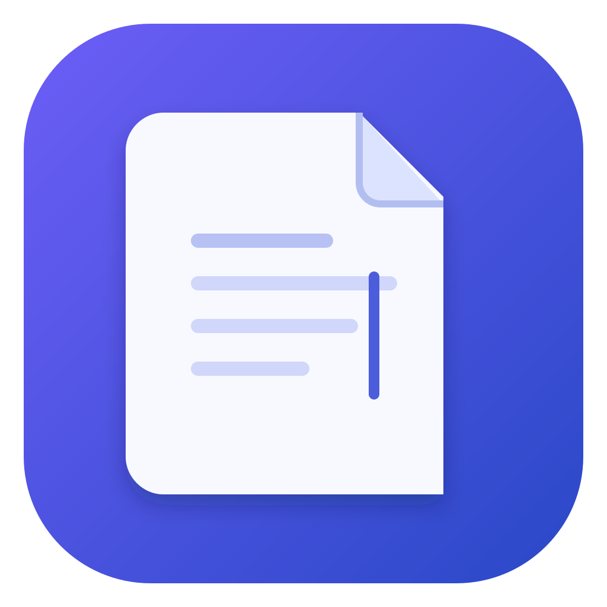

<p align="center">
  
</p>

# MacPad

**A familiar text-editing workflow, built to feel at home on macOS.**

MacPad is a native text and source-code editor for the moments when a note becomes a script, one file becomes several, and a simple search needs a regular expression. Inspired by Notepad++ workflows, it uses Swift and AppKit with Mac menus, shortcuts, and document tabs.


## Small details that make editing easier

- **Keep files together.** One app instance, multiple document tabs, modified/pinned indicators, close-group actions, and middle-click tab closing.
- **Find more precisely.** Normal, extended, and regex search; Replace All, match counts, and selected-token occurrence highlighting.
- **Control the text format.** Encoding, BOM, and LF / CRLF / CR line-ending controls.
- **Edit comfortably.** Line numbers, zoom, word wrap, common line transforms, and basic syntax highlighting.
- **Choose a readable workspace.** Font and color settings, Light/Dark modes, and themes including Dracula, Nord, Solarized, and One Dark.
- **Resume your work.** Session checkpoints and restoration, plus external-change detection with Reload / Keep Local choices.

MacPad has its own branding and implementation. It is an independent project, not an official Notepad++ port.

## Run from source

Requires **macOS 13+** and **Xcode with Swift 5.9 or later**.

```sh
git clone https://github.com/hiepkhach1005/Notepad.git
cd Notepad
swift run MacPad
```

To package a local development app:

```sh
./scripts/build-app.sh
open dist/MacPad.app
```

You can also open `Package.swift` in Xcode. The generated `.app` is an unsigned development bundle; signing and notarization remain release work.

## Development status

The native shell and the workflows above are implemented, with acceptance gaps tracked in [project state](docs/ai/PROJECT_STATE.md) and [known issues](docs/ai/KNOWN_ISSUES.md). Syntax highlighting is currently lightweight; full lexer parity, folding, multi-caret editing, and Find in Files remain planned. Plugin compatibility is outside the current scope.

Session restoration is not a substitute for saving files. Ambiguous/lossy encoding conversion and crash-recovery UX still need hardening, so keep backups of important documents while evaluating this preview.

## Validate and explore

```sh
swift build
swift test
```

Tests require the full Xcode toolchain. Read the [feature matrix](docs/ai/FEATURE_MATRIX.md), [architecture](docs/ai/ARCHITECTURE.md), and [parity tracker](docs/parity/README.md) to see what is implemented and what comes next.

Have a workflow you miss on Mac? [Open an issue](https://github.com/hiepkhach1005/Notepad/issues) with a small example and the expected behavior.
